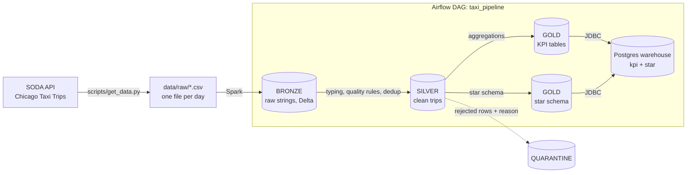

# Chicago Taxi Trips: medallion data pipeline

[](https://github.com/Moncif-M/test_technique_data_engineer_ma_Mouad/actions/workflows/ci.yml)

End-to-end, orchestrated pipeline that runs locally: raw CSV → **bronze** → **silver** → **gold** → SQL-queryable warehouse.
Orchestration with **Airflow**, processing with **PySpark + Delta Lake**, storage on an **S3-compatible object store**, everything started with **Docker Compose**.

## Architecture



Bronze, silver, quarantine and gold are Delta tables stored in the `lake` bucket of the object store (Silo, a maintained MinIO fork). The last task copies gold into a separate Postgres instance, so the BI team can query it with plain SQL.

| Service | Role | Port |
|---|---|---|
| `silo` | S3-compatible object store (the datalake) | 9000 (API), 9001 (console) |
| `minio-init` | one-shot: creates the lake bucket, then exits | internal |
| `postgres` | Airflow metadata only | internal |
| `warehouse` | Serving database for the gold tables | 5433 |
| `airflow-webserver`, `airflow-scheduler`, `airflow-init` | Orchestration | 8080 |

Spark runs in local mode inside the Airflow image (Spark 3.5.3, Delta 3.2.1, hadoop-aws 3.3.4, PostgreSQL JDBC 42.7.13). The image is built in two stages: a builder downloads the jars, and the runtime stage only carries Java, the pinned Python dependencies and those jars.

## Data

- **Source:** City of Chicago, [Taxi Trips 2013-2023](https://data.cityofchicago.org/Transportation/Taxi-Trips-2013-2023-/wrvz-psew) (dataset id `wrvz-psew`), through the SODA 2 CSV endpoint.
- **Period:** 1 January 2023 to 31 March 2023 (90 days), **1,446,439 trips**.
- **Download:** one CSV per day, paginated by 50,000 rows, with retries. Days already downloaded are skipped, so the script can be re-run and resumed. The January counts were checked against the API's per-day counts.

## Run it

**Prerequisites:** Docker with Compose v2, Python 3.11 (the download script also runs on 3.9+), about 8 GB of RAM, about 10 GB of free disk, and free ports 8080, 9000, 9001 and 5433.

```bash
# 1. Download the data (a few minutes). A virtual environment keeps pip away from the system Python.
python3 -m venv .venv
source .venv/bin/activate        # fish: source .venv/bin/activate.fish ; Windows: .venv\Scripts\activate
pip install requests
python scripts/get_data.py --start 2023-01-01 --end 2023-03-31

# 2. Start the stack (the first build takes a few minutes: images, Java, PySpark, jars)
docker compose up -d --build
docker compose ps -a             # airflow-init and minio-init must show "Exited (0)"

# 3. Trigger the pipeline (wait about 30 seconds after startup so Airflow has loaded the DAG)
docker compose exec airflow-scheduler airflow dags trigger taxi_pipeline
```

No `.env` file is needed: every setting has a default in `docker-compose.yml`. These are **local-development values, not secrets**. To override any of them (credentials, ports of the stack, Spark memory, `LOG_LEVEL`), copy `.env.example` to `.env` and edit it.

Follow the run at http://localhost:8080 (user `admin`, password `admin`). On a machine with 8 GB of RAM the full quarter takes several to tens of minutes, depending on the machine, with the tasks running one after another.

To process another date range:

```bash
docker compose exec airflow-scheduler airflow dags trigger taxi_pipeline --conf '{"start": "2023-01-01", "end": "2023-01-31"}'
```

**Check the results**

```bash
docker compose exec warehouse psql -U analytics -d analytics -c "select * from kpi.daily_revenue order by trip_date limit 5;"
docker compose exec warehouse psql -U analytics -d analytics -c "select * from star.dim_date order by date_key limit 5;"
```

The tables are in the `kpi` and `star` schemas and can also be queried from any SQL client at `localhost:5433` (user, password and database `analytics`). The lake is browsable at http://localhost:9001 (`minioadmin` / `minioadmin123`).

Stop everything with `docker compose down`. Add `-v` to delete all data (lake, warehouse, Airflow metadata).

### Troubleshooting

- **`DAG not found` when triggering:** the scheduler has not parsed the DAG yet. Wait 30 seconds and retry.
- **Out of memory (a task fails with exit code 137 or `Java heap space`):** if you copied `.env.example`, lower `SPARK_DRIVER_MEMORY` from `3g` to `2g` through `.env`, then `docker compose up -d`. Without a `.env` file the Compose default is already `2g`. Tasks already run one at a time.
- **`externally-managed-environment` when running pip:** use the virtual environment from step 1.
- **Tests fail with `RecursionError` or endless `when serializing function object` messages:** the venv was created with Python 3.12+. Delete it and recreate it with `python3.11 -m venv .venv`; PySpark 3.5.3 supports Python 3.8–3.11 only.
- **A port is already in use:** stop the program using it, or change the published port in `docker-compose.yml`.

## Pipeline

**Bronze** (`source_to_bronze_trips.py`): the CSVs are loaded as-is, every column stays a string. Three columns are added: `_source_file`, `_ingested_at` and the partition key `trip_date` (a literal copy of the date part of `trip_start_timestamp`). The write uses dynamic partition overwrite, so re-running a date range replaces only those days and never duplicates rows.

**Silver** (`bronze_to_silver_trips.py`):
- types the columns, renames the timestamps, and drops the redundant location text columns
- applies the quality rules below, first match wins
- removes duplicates on `trip_id`, keeping the latest ingestion
- adds `trip_date`, `trip_hour`, `trip_dow` and a `total_mismatch` flag
- writes rejected rows to a **quarantine** table, with their original values and a `reject_reason`

| Rule | Reason code |
|---|---|
| missing `trip_id` | `null_trip_id` |
| unparseable start or end timestamp | `invalid_start_timestamp`, `invalid_end_timestamp` |
| end before start | `end_before_start` |
| duration missing, zero or negative | `non_positive_duration` |
| duration over 24 h | `duration_outlier` |
| distance missing or negative, or over 200 miles | `invalid_distance`, `distance_outlier` |
| fare or total missing or negative | `invalid_fare`, `invalid_total` |

The per-run counts (kept, rejected, duplicates removed and the reject-reason breakdown) are written to the task log. The thresholds are judgment calls, informed by common cleaning practice on this dataset. The categorical columns (`payment_type`, `company`) were inspected and are already consistent in the source (7 and 35 distinct values), so no mapping was needed.

**Gold** (`gold_aggregate_trips.py`): four tables, rebuilt from silver on each run.

| Table | Content |
|---|---|
| `daily_revenue` | trips, revenue, fare revenue, tips and average total per day |
| `trip_stats_by_hour` | trips, average duration, distance and speed per hour of day |
| `top_pickup_zones` | trips and revenue per pickup community area, ranked |
| `payment_type_mix` | trips, revenue and share per payment type |

**Gold star schema** (`gold_star_schema_trips.py`): a second gold mart for dimensional models.

| Table | Content |
|---|---|
| `fact_trips` | one row per trip with date, payment and pickup/dropoff zone keys |
| `dim_date` | one row per calendar day in the processed range |
| `dim_payment_type` | payment types with deterministic hash keys |
| `dim_zone` | pickup/dropoff community areas plus `-1` for unknown zones |

Keys are deterministic (`xxhash64` for payment types) and missing areas map to `-1`, so every fact key has a matching dimension row.

**Exposure** (`gold_to_postgres_trips.py`): copies both gold marts to the `warehouse` Postgres, in the `kpi` and `star` schemas, ready for SQL clients or a BI tool.

### Validation

Row counts were reconciled across the layers: source API per-day counts against the downloaded files, bronze against the files, silver + quarantine + removed duplicates against bronze, and the gold totals against silver. Re-running the jobs on a date range leaves the totals unchanged.

## Tests and CI

The unit tests (22 cases from 18 test functions) cover the silver quality rules and dedup, the gold aggregates, and the star-schema keys. They run locally in a Spark session with no object store or Delta dependency:

PySpark 3.5.3 only supports Python 3.8–3.11, so create the test environment with Python 3.11 explicitly. Using the system `python` (3.12+) makes Spark's bundled cloudpickle fail with `RecursionError` and `when serializing function ...` messages:

```bash
python3.11 -m venv .venv              # must be 3.8–3.11; 3.11 is what CI uses
source .venv/bin/activate
pip install -r requirements-dev.txt
python -m pytest tests -q              # excludes the integration marker
ruff check . && ruff format --check .
```

The 5 integration tests run the real jobs against the running stack:

```bash
docker compose -f docker-compose.yml -f docker-compose.test.yml run --rm integration-tests
```

The root `pyproject.toml` holds both the pytest and Ruff configuration, so the lint commands above are exactly what CI runs. GitHub Actions runs the linter and the unit tests on every push and pull request (`.github/workflows/ci.yml`).

## Technical choices and trade-offs

- **Airflow 2.11 over 3.x:** the last 2.x release, with a minimal Compose footprint. Moving to 3.x is listed under next steps.
- **Delta Lake on an object store:** ACID writes, schema enforcement and partition-level overwrite, which makes every job idempotent.
- **Silo instead of MinIO:** the upstream MinIO repository is archived, and Silo is a maintained, API-compatible fork. The image is pinned to a dated release.
- **Multi-stage image:** the builder stage downloads the Hadoop/Delta/Postgres jars; the runtime stage only carries Java, the Python dependencies and those jars.
- **Logging and validation as first-class:** jobs use stdlib logging with `LOG_LEVEL` and fail fast on invalid date ranges, missing credentials, empty silver input or warehouse connection errors.
- **Spark in local mode:** one image and fewer moving parts, and it runs on an 8 GB laptop. A standalone cluster would add services without helping at this volume. Tasks run one after another, so a single JVM is in memory at a time.
- **Bronze left untouched:** raw strings, so data problems show up as quarantined rows in silver rather than as load failures.
- **Quarantine instead of silent filtering:** every rejected row is kept with its reason, so the rules can be reviewed.
- **No caching and no tuning:** recomputation is cheap at this volume, and the driver memory is better kept for the dedup shuffle.
- **Two Postgres instances (both PostgreSQL 16.4):** `postgres` holds Airflow's metadata only, and `warehouse` serves the BI team, so a heavy query cannot slow the scheduler.
- **Defaults in the Compose file:** `docker compose up` works with no setup. These are local-development values only.
- **Known limitations:**
  - dedup works within the date range being processed
  - the dataset rounds timestamps to 15 minutes, so durations are not compared with timestamp differences
  - gold is a full rebuild, not incremental

## With more time

- Add area names from the city's boundaries dataset to the zone dimension
- A data-quality framework (Great Expectations or Soda) on top of the existing quarantine rules
- A BI dashboard (Metabase or Superset) or an API on top of the warehouse
- Spark standalone cluster, Airflow 3, proper secrets management, and monitoring and alerting

## Repository layout

```
├── .github/workflows/  CI: lint + unit tests
├── pyproject.toml      ruff and pytest configuration
├── requirements*.txt   runtime and development dependencies
├── docker-compose.yml
├── docker-compose.test.yml  integration test overlay
├── .dockerignore
├── .env.example        optional overrides, documented
├── airflow/            multi-stage Dockerfile + dags/taxi_pipeline.py
├── spark/              utils/ (session, config, logging) and jobs/ (one script per step)
├── scripts/            get_data.py
├── tests/              unit tests + integration/ (Docker stack)
└── data/raw/           downloaded CSVs (not committed)
```
